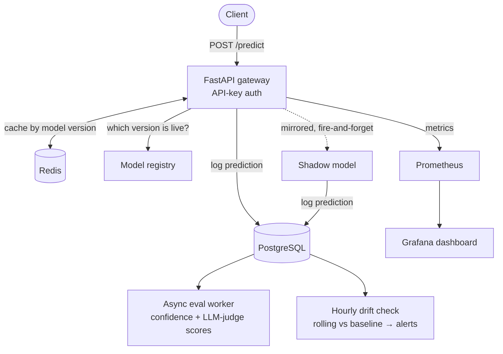

  

  <picture>
    <source media="(prefers-color-scheme: dark)" srcset="https://readme-typing-svg.demolab.com?font=Fira+Code&weight=500&size=20&pause=1200&color=A78BFA&center=true&vCenter=true&width=560&lines=Building+ML+systems+for+production;Shipping+LLM+agents+with+LangGraph;MSc+AI+for+Sustainable+Development+%40+UCL;Previously+data+science+%40+Vodafone" />
    
  </picture>

## Hi, I'm Yasemin 👋

I build ML systems and LLM agents. I'm doing an MSc in **AI at UCL**, after working as a data scientist and customer analyst at **Vodafone**.

- 🎓 MSc AI for Sustainable Development, UCL (2026–27) · BSc Computer Engineering, Bilkent University (GPA 3.78/4.00)
- 💼 Vodafone: Junior Data Scientist (Big Data & AI), then Junior Customer Analyst · NavigaAI: Applied AI Intern (LangChain / LangGraph agents) · Quin AI: Software Engineer Intern
- 🌱 Interested in responsible and sustainable AI, AI safety and generative AI
- 📍 London

## Featured work

| Project | What it does | Stack |
| --- | --- | --- |
| [**ML Serving Platform**](https://github.com/YaseminAkin/ml-serving-platform) | Model serving with a versioned registry, production promotion and shadow deployments, a Redis prediction cache, an async evaluation worker and statistical drift alerts, all monitored in Grafana | FastAPI · PostgreSQL · Redis · Prometheus · Grafana · Docker · GitHub Actions |
| **AI-Powered Animal Adoption App** 🔒 | React Native app that matches adopters with animals (unsupervised matching), with a LangGraph chatbot and CNN breed classification (CNN vs ResNet50 vs MobileNet). Built with NGOs and municipalities. 🏆 Social Impact Award, Bilkent CS Fair | React Native · LangGraph · CNNs (transfer learning) |
| **Road Anomaly Detection** 🔒 | Real-time classification and detection of road anomalies on self-collected data, evaluated on precision, recall and F1 | CNNs · YOLOv8 · Python |
| [**Musicbox**](https://github.com/YaseminAkin/yod-ai-musicbox) | Turns sheet music into audio and digital notation with Optical Music Recognition, plus a virtual piano with real-time feedback. Amazon University Engagement Program 2024 | Flask · React · OpenCV |
| [**Sarvène Atelier**](https://github.com/YaseminAkin/sarvene-atelier) | Storefront I build and maintain for a friend's company: catalogue, bag, checkout and accounts, with server-side re-pricing, signed sessions, rate limiting and a strict CSP | Next.js 16 · React 19 · TypeScript · Zod |

🔒 Code is private (team and partner projects). Happy to walk through them in an interview.

### 🔭 Spotlight: how the ML Serving Platform fits together

## Toolbox

  <picture>
    <source media="(prefers-color-scheme: dark)" srcset="https://skillicons.dev/icons?i=py,tensorflow,sklearn,opencv,r,postgres,mysql,fastapi,flask,docker,redis,prometheus,grafana,githubactions,git,react,nextjs,ts,js,java,cpp&perline=7&theme=dark" />
    
  </picture>

Also: LangChain · LangGraph · LangSmith · MLflow · Pandas · PySpark · Hive · YOLOv8

## Beyond the keyboard

- ⛷️ Ski instructor
- 🎾 Former professional tennis player, now just for fun (plus padel at UCL)
- 🎹 Piano, ABRSM Grade 3

## Get in touch

[LinkedIn](https://www.linkedin.com/in/yaseminakin2003) · Open to applied AI / ML engineering and data scientist roles in London

