<h3><code>yaseminakin@github ~ $ whoami</code></h3>
<table>
  <tr>
    <td valign="top"></td>
    <td valign="top"></td>
  </tr>
</table>

 

<h3><code>yaseminakin@github ~ $ ls ~/toolkit</code></h3>

  

<h3><code>yaseminakin@github ~ $ ./contact.sh</code></h3>
<a href="https://www.linkedin.com/in/yaseminakin2003"><code>linkedin.com/in/yaseminakin2003</code></a>
 
open to applied AI / ML engineering and data scientist roles in London

